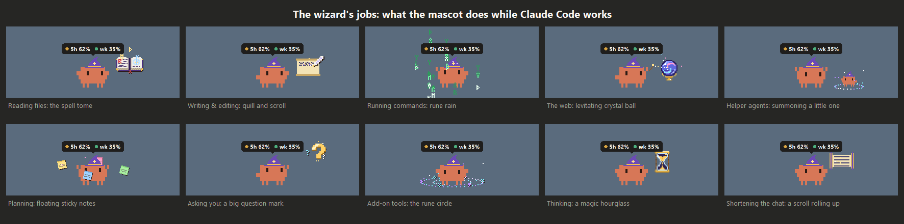

# Claude usage pet

A tiny pixel Claude mascot that lives on your Windows taskbar. A bubble above its head shows your Claude plan usage: the 5-hour and weekly limits, which cover claude.ai, the desktop app and Claude Code together.

  
  

  
  

What it does:

- Walks along the taskbar, hops now and then, and moves between monitors.
- Hover over it for a details panel with reset times and pace tips. It also has a Claude Code tab with real token counts, an activity grid and model stats, read from Claude Code's local logs.
- Puts on a wizard hat and casts sparkles while Claude is working.
- Talks in little speech bubbles: encouragement, silly quotes, milestones, and comments on what's going on.
- Click it to poke it. Drag it around (it dangles from where you grab it), or throw it: it screams, bounces, and opens a parachute on long falls.
- Dances now and then, gets bored, and asks for attention when you ignore it. When it's idle it might sweep the floor, paint a little picture, fish through a hole in the taskbar, blow up balloons (they pop), or throw a paper plane.
- Falls asleep when you're away, rings its bubble yellow, then red, as you near a limit, and remembers its moods across restarts.
- Hides while something is full-screen, and can land on top of your windows when it falls.
- Optional sound effects (with a volume slider) and desktop notifications.
- Keyboard shortcuts: Ctrl + Alt + P hides or shows it, and Ctrl + Alt + D pins the details panel. You can change them in Settings → Shortcuts.
- Right-click it for Refresh now, Play fetch, Quiet for an hour, Settings and Quit. The settings window has every option and what it does, and everything can be switched off, including all animations.
- A tray icon by the clock shows your usage when you hover it. Click it (or press Ctrl + Alt + H, or start the pet again) and the mascot comes running to your mouse, or parachutes in from above.
- A Sessions tab recaps your latest Claude Code sessions, and it sums each one up when it finishes. It warns you early if your pace would run out before the reset.
- Turns what Claude Code is doing into wizard magic: a spell tome for reading, a quill for writing, rune rain for commands, a crystal ball for the web, a summoned helper for agents, sticky notes for planning, a question mark when Claude asks you something, a rune circle for add-on tools and an hourglass while it thinks. It gets little apprentices when several sessions run at once, wears outfits on special days, plays fetch, and keeps a diary of everything it gets up to. Every so often something rare happens.

## What you need

- Windows 10 or 11 (tested on Windows 11).
- Python 3.10 or newer from [python.org](https://www.python.org/downloads/windows/) (tested with Python 3.14). No `pip install` needed: it only uses Python's standard library.
- [Claude Code](https://claude.com/claude-code) installed on the same computer and signed in with your Claude account (Pro or Max). The pet reads your usage through Claude Code's saved login. Signing in to only claude.ai or the desktop app isn't enough, and neither is a Claude Code API key.

## Install and start it

No terminal needed.

1. **Install Python.** Go to [python.org/downloads/windows](https://www.python.org/downloads/windows/), download the installer and run it. If the installer shows a "tcl/tk and IDLE" option, leave it ticked: the pet needs it to draw its windows. Skip the Microsoft Store version of Python.
2. **Download the pet.** On this page, click the green **Code** button, then **Download ZIP**.
3. **Unzip it** somewhere you'll keep it, for example your Documents folder. Right-click the ZIP, choose **Extract All**, and pick the folder. Avoid `Program Files`: the pet saves its settings next to its files and can't write there.
4. **Start it.** Open the extracted folder and double-click **`Start pet.bat`**. The mascot appears on your taskbar.
   - Windows may warn about a file from the internet the first time. Click **Run** (or **More info → Run anyway**) to go ahead.
   - If Python is missing, a window says so and opens the Python download page. If your Python is too old or incomplete, a pop-up says what to fix.
5. **Optional:** to start it every time you sign in to Windows, right-click the mascot, open **Settings → System** and turn on **Start with Windows**.

To stop it, right-click the mascot and choose **Quit**.

From a terminal, `py claude_pet.py` runs it with a console window, which shows errors as they happen.

## If something goes wrong

- **The bubble says "no login" or "login expired":** open Claude Code and sign in again. Hover over the mascot for step-by-step help.
- **Nothing appears:** look for `pet_errors.log` in the `data` folder, which says what went wrong. Also check it isn't hiding: press Ctrl + Alt + P.
- **"Start with Windows" stopped working after a Python update:** turn it off and on again in Settings → System.

The code lives in the `pet/` folder; `pet/__init__.py` explains what each file does.

## Privacy

- Your login token is read from `~/.claude/.credentials.json` on your own computer.
- It's only ever sent to `https://api.anthropic.com`.
- It's never printed, logged or saved anywhere else.

## Good to know

- The usage numbers come from an **undocumented** endpoint (`/api/oauth/usage`), so this can stop working at any time without notice.
- This is an unofficial fan project. It isn't affiliated with or endorsed by Anthropic. "Claude" and the Claude Code mascot design belong to Anthropic.

More detail, including how everything works, is in [PROJECT_NOTES.md](docs/PROJECT_NOTES.md).

## Licence

The code is under the [MIT licence](LICENSE). That covers this project's code only: the Claude name and the Claude Code mascot design belong to Anthropic.
