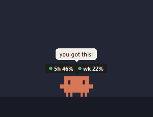
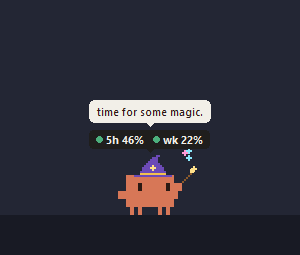
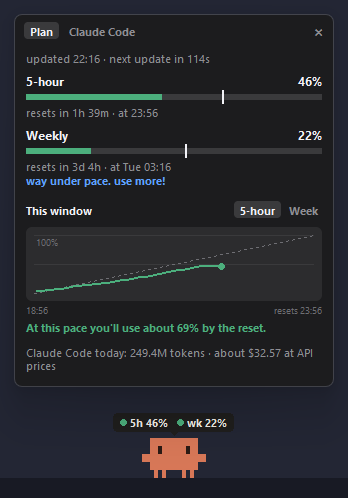
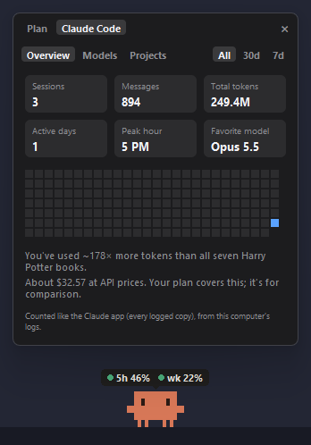

# Claude usage pet

A tiny pixel Claude mascot that lives on your Windows taskbar. A bubble above its head shows your Claude plan usage: the 5-hour and weekly limits, which cover claude.ai, the desktop app and Claude Code together.

<p>
  
  
</p>
<p>
  
  
</p>

What it does:

- Walks along the taskbar, hops now and then, and moves between monitors.
- Hover over it for a details panel with reset times and pace tips. It also has a Claude Code tab with real token counts, an activity grid and model stats, read from Claude Code's local logs.
- Puts on a wizard hat and casts sparkles while Claude is working.
- Talks in little speech bubbles: encouragement, silly quotes, milestones, and comments on what's going on.
- Click it to poke it. Drag it around (it dangles from where you grab it), or throw it: it screams, bounces, and opens a parachute on long falls.
- Dances now and then, gets bored, and asks for attention when you ignore it.
- Falls asleep when you're away, rings its bubble yellow, then red, as you near a limit, and remembers its moods across restarts.
- Hides while something is full-screen, and can land on top of your windows when it falls.
- Optional sound effects (with a volume slider) and desktop notifications.
- Keyboard shortcuts: Ctrl + Alt + P hides or shows it, and Ctrl + Alt + D pins the details panel. You can change them in Settings → Shortcuts.
- Right-click it for Refresh now, Settings and Quit. The settings window has every option and what it does, and everything can be switched off, including all animations.

## Requirements

- Windows 10 or 11 (tested on Windows 11).
- Python 3 with tkinter, which the standard python.org installer includes (tested with Python 3.14). No `pip install` needed, because it only uses the standard library.
- Claude Code installed and signed in on the same computer. The pet uses Claude Code's saved login.

## Run it

```bash
py claude_pet.py
```

Use `pyw claude_pet.py` (or `pythonw`) to run it without a console window. To start it when you sign in to Windows, right-click the mascot, open **Settings → System** and turn on **Start with Windows**.

The code lives in the `pet/` folder; `pet/__init__.py` explains what each file does.

## Privacy

- Your login token is read from `~/.claude/.credentials.json` on your own computer.
- It's only ever sent to `https://api.anthropic.com`.
- It's never printed, logged or saved anywhere else.

## Good to know

- The usage numbers come from an **undocumented** endpoint (`/api/oauth/usage`), so this can stop working at any time without notice.
- This is an unofficial fan project. It isn't affiliated with or endorsed by Anthropic. "Claude" and the Claude Code mascot design belong to Anthropic.

More detail, including how everything works, is in [PROJECT_NOTES.md](PROJECT_NOTES.md).

## Licence

The code is under the [MIT licence](LICENSE). That covers this project's code only: the Claude name and the Claude Code mascot design belong to Anthropic.
